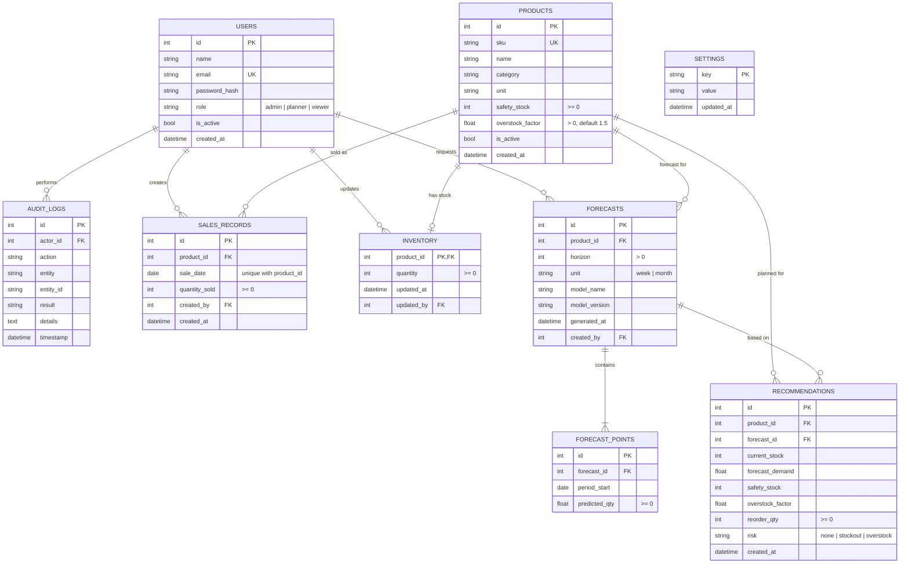

# DFIP - Entity Relationship Diagram

Source of truth: `backend/app/models/`. GitHub renders the diagram below.

## Notes
- Deleting a product deletes its inventory row, sales, forecasts and recommendations (`ON DELETE CASCADE`).
- Deleting a user keeps their records and sets the user reference to NULL (`ON DELETE SET NULL`).
- Recommendations copy the inputs they were calculated from, so DFIP-F-016 can show them later even if stock changes.
- Enums are stored as strings, so the same schema works on SQLite, MySQL and PostgreSQL.
